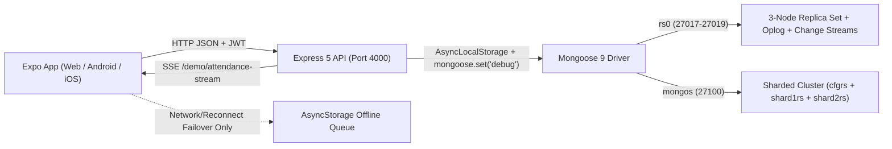

# Project Report: Campus Student (Konnakol Attendance & MongoDB System)

**Generated:** November 25, 2026  
**Repository:** `/home/piyush/Documents/DBMS/Mongo_DB/campus-student-` (`main` branch, based on commit `81ba733`)  
**Stack:** Expo SDK 58 / React Native `0.88.1` / TypeScript `~6.0.3` · Express `^5.3.0` / Mongoose `^9.12.2` / Node.js `v24.15.0` · MongoDB `7` (`mongo:7` Docker `rs0` replica set + sharded cluster)

---

## 1. Executive Summary

**Campus Student (Konnakol)** is a cross-platform attendance tracking application (Web, Android, iOS) for **Semester 5 Computer Engineering** at Goa College of Engineering, refactored from an offline local-storage prototype into a centralized MongoDB-backed distributed system.

All attendance state, percentage computations, risk classification (`SAFE >= 80%`, `AT_RISK 75–79%`, `DEFAULTER < 75%` via `course.minAttendance`, `NO_DATA` when `P + A = 0`), schedule filtering, and notifications are computed on the Express/MongoDB backend. Every API endpoint wraps responses in a standardized observability envelope (`{ data, meta: { ms, concepts, queries } }`) powered by `AsyncLocalStorage`, `mongoose.set('debug', cb)`, and a route-level `tag(req, topic, operators, why)` helper—driving both an in-app **Demo Mode** query inspector and an admin-only **Demo Center** covering all 10 MongoDB course topics.

---

## 2. System Architecture

### Core Architectural Decisions
- **Zero Direct DB Access from Clients:** Clients call the API at `EXPO_PUBLIC_API_URL` (`http://192.168.31.151:4000`, LAN IP configured in `.env`).
- **Timezones & Dates:** All `markedAt` and `createdAt` timestamps are stored as UTC `Date`s in MongoDB; attendance day boundaries use `dateKey` (`YYYY-MM-DD`) evaluated in `Asia/Kolkata` (`IST`), and UI/history displays format in IST.
- **Offline Queue Policy:** `AsyncStorage` is no longer used for reading/computing attendance totals. It acts strictly as an offline write buffer (`konnakol_offline_attendance_queue_v1`) when `PUT /attendance` fails due to network errors or replica-set `{ status: "reconnecting" }` responses (`503`), flushing automatically on reconnect or app foreground.
- **Auth & Role Separation:** Real `POST /auth/login` and `POST /auth/register` return JWTs stored in `expo-secure-store` (with `AsyncStorage` fallback on Web). Student accounts route to `/home`; `admin` (`admin@gec.ac.in`) routes to `/demo-center`. Note: backend `authenticateToken` intentionally remains permissive in `server/middleware/auth.js` for API testing (falling back to demo student Noah `nnm1.s24@gec.ac.in` when no Bearer token is provided), while destructive routes like `POST /demo/reset` enforce `role === 'admin'` when an `Authorization` header is passed.

---

## 3. Data Model, `$jsonSchema` Validation & Indexing

All legacy orphaned models (`AttendanceRecord`, `AttendanceSession`, `NotificationPreference`, `StudentEnrollment`, `Timetable`, `TimetableException`, `Subject`) and `scripts/auth-server.mjs` / `smart-campus/` were removed. Exactly **7 collections** remain, enforced on MongoDB via `server/db/setup.ts` with `validationLevel: "strict"` and `validationAction: "error"`:

| Collection | Key Fields (BSON Types) | Schema & Validation Rules | Indexes |
| :--- | :--- | :--- | :--- |
| **`users`** | `name` (`string`), `email` (`string`), `password` (`string`), `role` (`enum`), `isActive` (`bool`) | `role` in `['student','faculty','admin']`; bcrypt pre-save hash | `uniq_users_email` (`{ email: 1 }`, unique) |
| **`students`** | `userId` (`objectId`), `rollNo` (`string`), `semester` (`int`), `section`, `batch`, `labBatch`, `status`, `guardian` (`object`) | `section` `A/B/C`, `batch`/`labBatch` `C/D`, `status` `active/dropped`, `guardian.phone` minLength 8 | `uniq_students_rollNo` (unique), `text_students_name_rollNo` (`text`), `idx_students_userId`, `idx_students_sem_sec_batch` |
| **`courses`** | `code`, `name`, `shortName`, `type`, `category`, `credits`, `semester`, `minAttendance` (`int`) | `type` `theory/lab/other`, `category` `mandatory/elective/activity` (includes `NCC301` Activity + 5 Theory + 5 Lab) | `uniq_courses_code` (unique), `idx_courses_sem_cat` |
| **`timetable_slots`** | `slotKey`, `semester`, `section`, `day`, `start`, `end`, `courseId`, `type`, `batch` (`string/null`), `room` | `batch: null` for theory & `NCC301` activity; `'C'`/`'D'` for labs; `HH:mm` regex | `idx_slots_sem_sec_day_start`, `uniq_slots_sem_sec_key` (unique) |
| **`attendance`** | `studentId` (`objectId`), `courseId` (`objectId`), `slotId` (`objectId`), `dateKey` (`YYYY-MM-DD`), `status` (`P`/`A`), `markedAt` (`date`), `source` | `status` enum `['P','A']` (code `121` rejects invalid statuses); `source` `seed/manual/qr/sync/api` | **`uniq_attendance_student_date_slot`** (`{ studentId: 1, dateKey: 1, slotId: 1 }`, unique shard-key prefix), `idx_attendance_student_course`, `idx_attendance_student_markedAt` |
| **`notifications`** | `studentId`, `courseId`, `slotId`, `type`, `title`, `body`, `read` (`bool`), `createdAt` (`date`) | `type` in `lecture_started`, `low_attendance_warning`, `attendance_marked`, `system` | `idx_notif_student_read_createdAt`, **`studentId_hashed`** (`{ studentId: 'hashed' }`), **`ttl_notif_createdAt_90d`** (`expireAfterSeconds: 7776000`) |
| **`audit_log`** | `actorId`, `studentId`, `action`, `collectionName`, `documentId`, `before`, `after`, `metadata`, `createdAt` | Transactional audit trail on `PUT /attendance` status transitions, soft deletes, rollovers, and seeds | `idx_audit_student_createdAt`, `idx_audit_action_createdAt` |

---

## 4. Backend Services, API Endpoints & Query Observability

### Request-Level Tracing (`server/utils/mongoTrace.js`)
1. `mongoTraceMiddleware` starts an `AsyncLocalStorage` store (`{ startMs, concepts, queries, _debugAggregateCount }`) for every HTTP request and wraps `res.json` so **every** JSON response—including `/demo/health`, `404`, rate-limit `429`, `503 reconnecting`, and `500`—returns `{ data, meta: { ms, concepts, queries } }`.
2. `installMongooseDebugHook()` registers `mongoose.set('debug', cb)` globally, capturing actual queries (`find`, `findOne`, `countDocuments`, `aggregate`, `updateOne`, `insertOne`, `insertMany`, `deleteOne`, `deleteMany`, etc.) while safely stripping circular `ClientSession` objects in replica-set transactions and redacting plaintext credential strings.
3. `runAggregate(modelOrCol, pipeline, options)` executes aggregations (applying `.option(options)` hints on Mongoose `Aggregate`) and falls back to logging `capturedBy: 'aggregate-wrapper'` if `mongoose.set('debug')` fails to emit.
4. `recordQuery(...)` logs raw driver calls (`admin().ping()`, `buildInfo`, `replSetGetStatus`, `listShards`, `listCollections`, `indexes()`), and `runExplain(...)` captures `explain('executionStats')` probes with hints.
5. `tag(req, topic, operators, why)` attaches deduplicated Topic `1–10` metadata to `meta.concepts`.

### Centralized Analytics (`server/services/attendanceStats.js`)
The single source of truth for all attendance percentages and risk calculations:
- `getOverallStats`: `$match` -> `batchFilterStages(activeBatch)` (`$lookup timetable_slots` -> `$unwind` -> `$match { $or: [{ 'slot.batch': null }, { 'slot.batch': activeBatch }] }`) -> `$group` -> `$divide` / `$round` -> `risk`.
- `getPerSubjectStats`: per-course `$group` + `$lookup courses` + `$unwind` + `classesNeeded` deficit formula against `course.minAttendance`, merged across all 11 Sem 5 courses (including `NCC301`).
- `getTodayStats`: `timetable_slots` filtered by student's semester/section/batch -> `$lookup attendance` for target IST `dateKey` -> `$facet` computing `Total`, `Present`, `Absent`, and `Pending` (`Total - marked`).
- `getMonthlyStats`: `$group` using `{ $year/$month with timezone: 'Asia/Kolkata' }` merged against IST weekday schedule counts across all 11 courses to produce real `scheduled` and `pending` counts.
- `getCourseSummary`, `getDefaultersList` (active students `< threshold` joined with `guardian.phone`), `get14DayTrend` (`$facet` rolling 14-day vs overall), `getStudent360` (multi-pipeline `$facet`), and `explainAttendanceQuery`.

### Route Groups (`server/routes/`)
| Mount Path | File | Key Operations & MongoDB Topics |
| :--- | :--- | :--- |
| `/auth` | `auth.js` | `POST /register`, `POST /login` (`findOne` projection), `GET /me` (**T3**) |
| `/me` | `me.js` | `GET /me`, `PATCH /me/batch` (`updateOne $set`) (**T3, T4**) |
| `/courses`, `/subjects` | `courses.js` | `GET /` (`find` + `countDocuments` for Theory(5)/Lab(5)/Other(1)), `POST/PUT/DELETE /:id` (**T3, T4**) |
| `/timetable` | `timetable.js` | `GET /?day=` (`$and` + `$or [{batch:null},{batch}]` + `sort({start:1})`), `POST /` (**T3, T5**) |
| `/attendance` | `attendance.js` | `GET /`, `GET /history`, `PUT /` (shard-key-prefixed upsert inside `session.withTransaction` with `w: 'majority'` + `audit_log` insert + future/batch/dropped/`$jsonSchema` 121 guards), `DELETE /`, `DELETE /reset`, `GET /stats` (**T2, T4, T6, T8**) |
| `/analytics` | `analytics.js` | `/overall`, `/subjects`, `/today`, `/monthly`, `/course-summary`, `/defaulters`, `/trend`, `/student-360`, `/explain` (**T2, T6, T7, T10**) |
| `/notifications` | `notifications.js` | `GET /`, `GET /unread-count` (`countDocuments`), `PATCH /read-all` (`updateMany`), `PATCH /:id/read`, `DELETE /` (**T3, T4**) |
| `/students` | `students.js` | `GET /` (`$and/$in/$gte/$lte/$ne/$regex`, offset `skip/limit` AND keyset `rollNo > lastSeen`), `DELETE /:id` (`status: 'dropped'` soft delete) (**T3, T4, T5**) |
| `/admin` | `admin.js` | `GET /explorer/:collection` (BSON type map + 5 samples), `GET /validators`, `POST /import/attendance` (`insertMany` `ordered:false` error report), `POST /rollover` (`updateMany $inc`), `DELETE /attendance/before` (`deleteMany $lt`) (**T2, T3, T4**) |
| `/demo` | `demo.js` | `/health` (**T1, T8**), `/replica-set`, `/oplog`, `/write-concern-test` (**T8**), `/sharding` (**T9**), `/benchmark` (**T10**), `/reset` (**T3, T4**), `/attendance-stream` SSE Change Stream (**T8**) |

---

## 5. Client Application Layer (`src/`)

- **Screens Wired to API via `useFocusEffect` + SSE Live Sync:** `home.tsx`, `today.tsx`, `yesterday.tsx`, `subjects.tsx`, `monthly-reports.tsx`, `timetable.tsx`, `notifications.tsx`, `calendar.tsx`, `attendance-history.tsx`, `profile.tsx`.
  - Fixed screen consistency bugs: Home `"x/4 marked"` uses `attendedClasses + absentClasses`; `subjects.tsx` renders all 11 courses (`NCC301` badged `ACTIVITY`); `monthly-reports.tsx` displays real `Scheduled`, `Present`, `Absent`, `Pending` columns; `calendar.tsx` matches `"P"`/`"A"` via `dateKey`; threshold colors come from API `risk` and `minAttendance`.
- **Demo Mode (`src/services/demo-mode.ts`, `src/components/demo-inspector-sheet.tsx`):**
  - **Long-press (450ms)** on the Home greeting header (`GOA COLLEGE OF ENGINEERING / Hi, {userName}`) toggles Demo Mode (`AsyncStorage`-persisted).
  - Every API request records `{ method, path, status, meta }` into a burst-grouped store (prioritizing mutations over follow-up refreshes) and opens a modal bottom sheet displaying `Topic <n> · <ops>` badges, explanations, exact formatted query JSON, and `ms` taken.
- **SSE Live Change Stream & `<75%` Alert (`src/services/attendance-stream.ts`, `src/app/_layout.tsx`):**
  - Uses `EventSource` on Web and progressive `XMLHttpRequest` on React Native to listen on `GET /demo/attendance-stream`.
  - Automatically refreshes open student screens via `useAttendanceLiveSync` when another device changes attendance (`markLocalAttendanceMutation` suppresses duplicate local echoes) and shows a global alert toast when `low_attendance_alert` fires (`percentage < 75%`).
- **Admin-Only Hidden Screen (`src/app/demo-center.tsx`, `src/services/demo-center.ts`):**
  - Guarded to `user.role === 'admin'`; provides tabs **`Health (T1)`**, **`Explorer (T2)`**, **`Replica Set (T8)`**, **`Sharding (T9)`**, and **`Comparison (T10)`**, live SSE event log, `Reset Demo Data`, and `Logout`.

---

## 6. Infrastructure & Sharding Design (`infra/`)

- **`infra/docker-compose.yml`:**
  - **Default (`rs0`):** 3-node replica set (`campus_mongo1`:27017, `campus_mongo2`:27018, `campus_mongo3`:27019) initialized by `campus_mongo_init` (`up-rs.sh`, `kill-primary.sh`, `restore.sh`). Host URI: `mongodb://localhost:27017,localhost:27018,localhost:27019/campus_student?replicaSet=rs0`.
  - **`sharded` & `light` Profiles:** Config Server RS (`cfgrs`), two Shard RS (`shard1rs`, `shard2rs`), and `mongos` router on port **`27100`** (`up-sharded.sh`, `infra/scripts/sharded-rs-init.sh`, `mongos-entrypoint.sh`, `sharded-init.sh`). Full `sharded` profile runs 3 nodes per RS; `light` profile runs 1 node each.
- **Shard Keys:**
  - `attendance`: range shard key **`{ studentId: 1, dateKey: 1 }`** backed by unique index `{ studentId: 1, dateKey: 1, slotId: 1 }`. Prefixing with `studentId` distributes concurrent same-day writes across shards (avoiding the trailing-chunk monotonic write hotspot caused by `dateKey` alone) while keeping each student's history co-located for single-shard queries.
  - `notifications`: hashed shard key **`{ studentId: "hashed" }`** (`4` initial chunks balanced `2/2` across `shard1rs` and `shard2rs`).
- **Seeding (`server/seed.js`):**
  - Default `npm run seed` (`rs0`): `304` users, `300` students, `11` courses, `81` timetable slots, `102,563` Aug–Nov 2026 attendance rows (`12` marks for Noah `nnm1.s24@gec.ac.in` / `demo123`), `12` notifications, `1` `audit_log` row.
  - Sharded `npm run seed:sharded` (`mongos:27100`): `624` users, `620` students, **`212,313` attendance rows** (pre-split at student quartiles across `shard1rs`/`shard2rs`), `102` notifications.

---

## 7. Verification Summary & Known Limitations

### Executed & Verified Passing
1. **Static Checks:** `npx tsc --noEmit` (`0` errors) and `npm run lint` (`0` errors, `0` warnings).
2. **Automated Integration Suite (`npm test` -> `server/__tests__/api.test.js`):** **17/17 tests passed** covering auth, course counts, timetable filters, batch update, transactional attendance upsert/undo/rejections, notifications, pagination/filters, CSV import/rollover/purge, analytics/explain, `AsyncLocalStorage` + `mongoose.set('debug')` + `tag()` + `runAggregate`, `/demo/sharding`, `/demo/replica-set`, `/demo/oplog`, `/demo/write-concern-test`, `/demo/benchmark`, `/demo/attendance-stream` SSE + `<75%` alert, and `/demo/reset`.
3. **Seed & Failover Test:** `npm run seed` succeeded in `38,882 ms`. A continuous 20-write `PUT /attendance` loop during `kill-primary.sh` (stopping `mongo2` and failing over to `mongo1`) completed with **`20/20` acknowledged (`0` lost writes)**, and `restore.sh` rejoined all 3 nodes.
4. **Sharded Cluster (`--profile light` + `npm run seed:sharded`):** Verified `212,313` attendance docs (`shard1rs`: `99,424` docs / `3` chunks; `shard2rs`: `119,439` docs / `3` chunks) and `102` notifications (`44`/`58` across `2`/`2` chunks) via `mongos:27100` and `GET /demo/sharding`.
5. **Explain & Benchmark Metrics (Live `rs0` API):**
   - `GET /analytics/explain`: `COLLSCAN` `102,563` docs (`193 ms`) vs `IXSCAN` `2` docs (`1 ms`).
   - `GET /demo/benchmark?rollNo=24CE002` (all `286/343 = 83.4%`): Node loop `192.34 ms` vs `$group` no-index `84.48 ms` vs `$group` indexed `3.24 ms`.
   - `POST /demo/write-concern-test` (15 iterations): `w: 1` `98 ms` (`6.53 ms/op`) vs `w: "majority"` `114 ms` (`7.6 ms/op`).
6. **Student Consistency Check (`nnm1.s24@gec.ac.in`, Batch `C`):** Home (`9/12 = 75%`, `0/4 marked`), Today (`Total: 4, Pending: 4`), Subjects (`11` courses summing to `9P / 3A / 12M = 75%`), and November Monthly Reports (`Scheduled: 75, Present: 9, Absent: 3, Pending: 63 = 75%`) agree via backend APIs.

### Not Executed Live
- **Interactive Browser / Phone UI Walkthrough:** Chrome DevTools MCP (`list_pages`) could not attach because Chrome remote debugging (`DevToolsActivePort`) was not enabled on the host, and no physical phone was connected to Expo Go. UI interactions (Demo Center charts/tabs, long-press Demo Mode bottom sheet, and phone-to-web SSE sync) await a live browser/device check.
- **Full 3-Node-Per-RS Sharded Profile (`--profile sharded`):** Config validated via `docker compose --profile sharded config --quiet`; only `--profile light` was booted live to fit host RAM.
- **Git Commit:** All recent backend, frontend, and infra additions are currently uncommitted in the working tree (ready for review/commit).

---

## 8. Companion Documentation & Running Services
- **Demo Walkthrough:** `DEMO_SCRIPT.md` (10-minute step-by-step flow with topic badges)
- **Shell Reference:** `infra/DEMO_COMMANDS.md` (`mongosh` Topic 1, 8, and 9 commands)
- **Seeded Credentials:** Student `nnm1.s24@gec.ac.in` / `demo123` · Admin `admin@gec.ac.in` / `admin123` · Faculty `{sharma.a,mehta.r,patel.s}@gec.ac.in` / `faculty123` · Students `stu002.s24@gec.ac.in`..`stu300.s24@gec.ac.in` / `student123`
